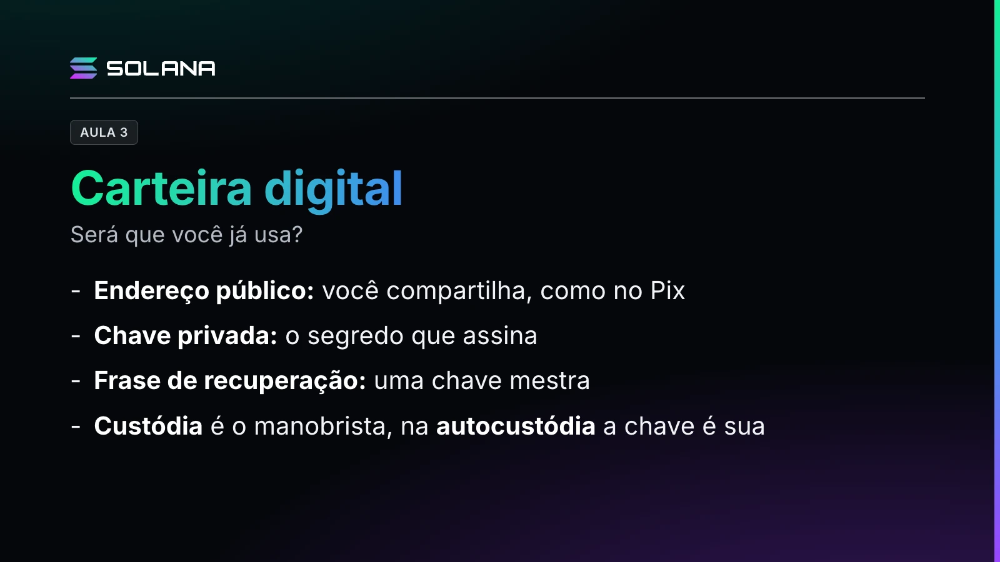

O professor apresenta a carteira digital e a diferença entre custódia e autocustódia.

## O que a carteira faz

Pagar a conta do restaurante encostando o celular já é usar uma carteira digital. No universo Solana, as mais conhecidas são a Phantom e a Solflare: elas mostram o seu saldo em SOL, o token nativo da rede, e permitem autorizar operações.

O ponto principal: os ativos não ficam dentro do aplicativo. Eles estão registrados na blockchain, e a carteira administra as chaves que permitem movimentá-los.

## Três conceitos

- **Endereço público:** uma sequência de letras e números que identifica a sua conta. É o que você passa para um colega te enviar SOL, como uma chave Pix. Cuidado: as movimentações e os saldos desse endereço podem ser consultados por qualquer pessoa.
- **Chave privada:** o segredo que assina digitalmente as operações. Na cidade inteligente, é a sua credencial para autorizar movimentações.
- **Frase de recuperação:** uma sequência de palavras que reconstrói as chaves se você perder o acesso, como uma chave mestra. Guarde fora da internet, em local protegido.

> **Nota de segurança da lição (não está no vídeo).** A chave privada e a frase de recuperação não devem ser compartilhadas com ninguém, nem com quem disser que é do "suporte".

## Custódia e autocustódia

O professor usa o estacionamento para explicar os dois modelos.

- **Custódia** é o estacionamento com manobrista: você entrega a chave e paga pelo serviço. Uma empresa cuida da movimentação por você, com login e senha, como num banco. É confortável para quem está começando, mas, se o serviço sair do ar, você depende dele.
- **Autocustódia** é estacionar você mesmo: a responsabilidade é toda sua. Não existe "ah, esqueci, recuperação de senha", então é preciso mais maturidade para saber o que está fazendo. Existem dispositivos físicos que facilitam esse processo.
