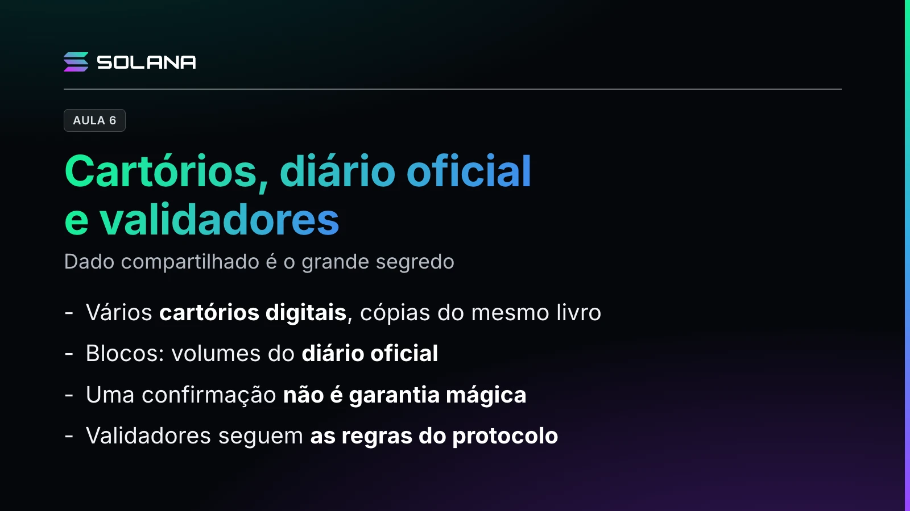

O professor explica como uma blockchain funciona por dentro: o registro compartilhado, os blocos e os validadores.

## Vários cartórios digitais

Numa cidade inteligente, cada empresa tem o seu banco de dados. A blockchain oferece outra possibilidade: um histórico compartilhado entre diferentes entidades. Dado compartilhado é o grande segredo, mas isso não significa que qualquer pessoa possa escrever qualquer informação: o registro é compartilhado, e as alterações precisam seguir o protocolo.

Pense em vários cartórios digitais com cópias sincronizadas do mesmo livro. Em uma blockchain pública, qualquer pessoa pode verificar se uma operação foi incluída, mas consultar não significa necessariamente conhecer a identidade real das pessoas envolvidas.

Uma transação é como um documento que pede uma mudança no cadastro: o sistema confere a autorização, os dados e as regras. Por isso a blockchain não é só um depósito de dados, é uma máquina de estados: recebe operações válidas e passa de uma situação anterior para uma nova situação.

## O diário oficial e as confirmações

Os blocos são como volumes numerados do diário oficial da cidade digital: cada um reúne acontecimentos aceitos e se conecta ao volume anterior, estabelecendo uma ordem. Quando uma transação entra em um bloco, recebe uma confirmação inicial; os blocos produzidos depois aumentam as confirmações e, dependendo do funcionamento de cada rede, tornam a reversão mais difícil.

Com uma expressão cuidadosa: uma confirmação não é garantia mágica e absoluta. Ela indica que a transação foi incluída no histórico aceito. Quanto maior o valor ou o risco da operação, mais confirmações um serviço pode decidir aguardar.

## Os validadores

Os validadores são como agentes autorizados que verificam os documentos antes do registro oficial. O checklist deles:

- A assinatura digital é válida?
- A pessoa possui os recursos que pretende transferir?
- A operação respeita as regras do protocolo?
- A mesma unidade de valor já foi usada em outra operação incompatível?

Alguns validadores propõem blocos e outros verificam a proposta. Eles não decidem por preferência pessoal: executam as regras do protocolo. Quem aceita informações inválidas pode ter a proposta rejeitada e, em algumas redes, sofrer penalidades econômicas.
