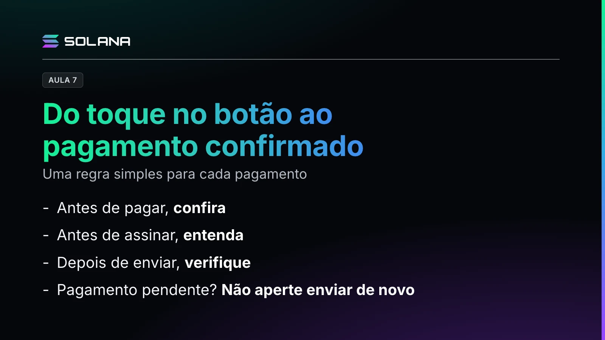

O professor acompanha o caminho entre tocar no botão e ter um pagamento confirmado na Solana, pagando 5 USDC pelo estacionamento. O USDC é um token que busca acompanhar o dólar.

## Os passos

1. **Conferir os dados:** de qual conta sai, qual endereço recebe, qual ativo e qual quantidade. É como conferir a maquininha antes de aproximar o cartão.
2. **Entender o pedido:** a transação é um envelope com ordens, chamadas instruções: transfira o pagamento e registre o período de estacionamento comprado.
3. **Ler a prévia:** a carteira mostra quanto sai, para onde vai e quais permissões serão dadas, e pode simular a operação.
4. **Assinar e enviar:** a carteira usa a chave privada para criar uma assinatura digital, um selo que comprova a autorização. A rede verifica o selo sem receber a chave privada, e enviada ainda não significa concluída.
5. **Acompanhar a confirmação:** três termos. Processed: a operação foi processada em um bloco, mas o registro ainda pode mudar. Confirmed: o bloco recebeu votos suficientes dos validadores. Finalized: o nível mais forte de confirmação.

> **Nota editorial (2 de novembro de 2026).** O vídeo descreve os três nomes como eles funcionavam antes do Alpenglow, ativo na rede principal desde 21 de outubro de 2026. Os três continuam existindo nas ferramentas, mas, segundo a Solana Foundation, `confirmed` e `finalized` agora descrevem o mesmo estado, e `confirmed` deve ser removido em uma versão futura.

Confira separadamente se o pagamento teve sucesso e se o registro foi finalizado: uma operação que falhou também pode ter o registro de erro finalizado.

## Taxa e comprovante

O estacionamento recebe USDC, mas a taxa da rede é paga em SOL, por você ou por um serviço que pague em seu lugar. Existe uma taxa base relacionada às assinaturas exigidas. No fim, use a assinatura da transação como número de protocolo no explorador para conferir o comprovante. Não existe botão geral de desfazer.

## Confira, entenda e verifique

Antes de pagar, confira. Antes de assinar, entenda. Depois de enviar, verifique. Se o pagamento aparecer como pendente, não aperte "enviar" de novo: consulte primeiro a transação no explorador, porque os dois pagamentos podem ser concluídos. Para um endereço novo, teste antes uma pequena quantia.
