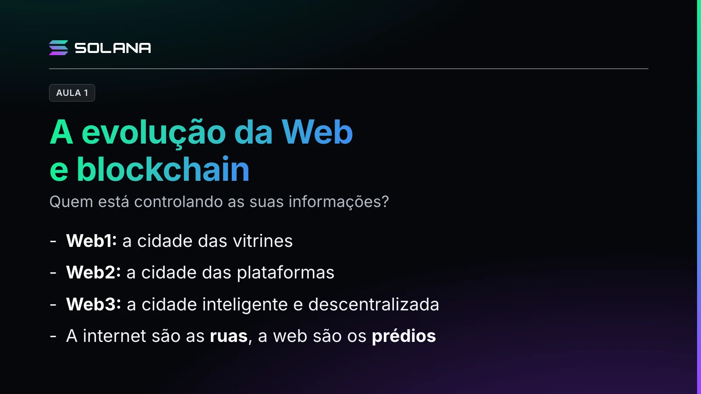

O professor apresenta a Web3 e a blockchain a partir de uma pergunta: e se a sua vida digital sumisse amanhã, porque pertence às big techs? As plataformas oferecem serviços maravilhosos, mas sob as regras delas. A Web3 propõe que isso também possa ser seu.

## A cidade digital

Ele usa a analogia da cidade inteligente:

- **Internet** são as ruas e avenidas: a infraestrutura que conecta redes, computadores, celulares e outros dispositivos.
- **Web** são os prédios e serviços construídos nessas ruas: páginas e aplicações interligadas que funcionam sobre a internet.
- **Protocolos** são as regras de trânsito: o TCP/IP organiza a comunicação entre redes, o DNS localiza os endereços dos sites e o HTTP liga navegadores e servidores.

## Web1, Web2 e Web3

- **Web1, a cidade das vitrines:** páginas simples, de leitura, com pouca interação.
- **Web2, a cidade das plataformas:** a web participativa das redes sociais, da Wikipedia e do GitHub. Vale o efeito da rede: sem gente publicando e trocando, o site morre. O problema é que as plataformas concentram os dados e as decisões. É como uma casa no terreno de outra pessoa: o proprietário define as regras e pode mudar o algoritmo ou suspender a sua conta. Há um controlador central e uma relação de dependência.
- **Web3, a cidade inteligente:** construída sobre a blockchain, um registro urbano compartilhado. A carteira é a identidade, a assinatura e a chave do cidadão, os edifícios são aplicações descentralizadas e as ruas são as redes blockchain.

Três termos da Web3:

- **Wallet**, ou carteira criptográfica: controla as chaves digitais e autoriza operações.
- **Token:** uma unidade digital registrada conforme as regras de uma rede.
- **Smart contract**, ou contrato inteligente: um programa executado pela blockchain, que funciona como uma regra urbana aplicada quando determinadas condições são atendidas.

> **Nota editorial.** Na Solana, um contrato inteligente só é executado quando uma transação o chama.

## O cartório digital

O professor propõe imaginar um cartório digital cujo registro não fica num único computador central: vários computadores mantêm e verificam cópias do histórico, seguindo regras comuns. As informações são agrupadas em blocos conectados criptograficamente, e nenhum participante pode modificar sozinho o histórico reconhecido pela rede.

Uma ressalva fundamental: a blockchain não torna toda informação verdadeira. Ela preserva e verifica o que foi registrado, mas não garante que corresponda à realidade externa.

No fim, a Web3 é uma nova visão sobre quem controla as suas informações e os seus ativos.
