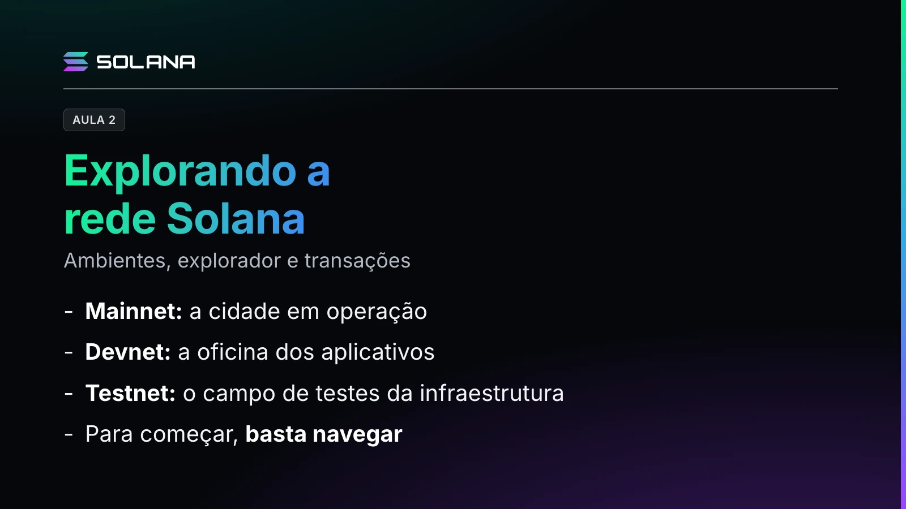

Olá, sou o professor Marcos Crivelaro. Venho aqui trazer novamente mais ensinamentos sobre o universo Solana e o universo blockchain. Vamos continuar aqui tendo como exemplo base uma cidade inteligente, uma smart city.

## O que você faz ao chegar numa smart city?

Você chega numa smart city, o que você faz? Primeiro você observa, vai dar uma volta no seu quarteirão, ou de carro, se você chegou de carro. Depois você começa a experimentar alguns aplicativos que você baixou sobre a cidade: restaurantes, estacionamentos, hotéis, lazer. E depois você começa a fazer pagamentos. Então, você levou um cartão de crédito, de débito, você levou o dólar.

Vamos fazer essa mesma analogia aqui, conhecendo os ambientes onde a Solana está e focando principalmente numa transação.

Então, para começar, basta navegar, já que você está apenas conhecendo. Não precisamos nem instalar uma carteira nem inserir dinheiro nessa rede.

## Exemplo: um aplicativo de estacionamento

Vamos dar um exemplo aqui bem focado: um aplicativo para estacionamento. Estacionamento a céu aberto, por exemplo. Com isso, a gente vai poder explicar três conceitos: Mainnet, Devnet e Testnet.

### Mainnet

Vamos começar pela Mainnet. É a rede principal. Lá no estacionamento, que é aberto ao público, os motoristas utilizam o serviço e fazem o pagamento pelo uso desse estacionamento. Na Solana, é o ambiente em que as aplicações funcionam para valer. Os ativos podem ter valor econômico e os pagamentos são feitos.

### Devnet

Outro conceito é a Devnet. É o ambiente de aprendizagem e desenvolvimento. Seria a oficina em que a equipe experimenta o aplicativo antes de oferecê-lo aos motoristas. Nela, usamos token de teste, sem valor econômico. Ter 10 SOL de teste não significa ter 10 SOL para gastar na rede principal. É como receber créditos de demonstração para aprender a usar o estacionamento.

### Testnet

Já a Testnet tem foco nos testes da própria rede e dos validadores, os computadores que ajudam a verificar as operações e a chegar a um acordo sobre os registros. Na cidade, seria como testar a infraestrutura. Ela suporta mais movimento? Continua funcionando depois de uma atualização?

### Para resumir

Mainnet é a cidade em operação. Devnet é a oficina dos aplicativos. E Testnet é o campo de testes da infraestrutura.

## Como observar o movimento da cidade digital

Agora, como observar o movimento dessa cidade digital? Usamos um explorador de blocos, como o Solana Explorer. Pense nele como um painel público de consulta. Você pesquisa uma operação e encontra informações registradas na blockchain, também chamadas de dados on-chain. Tudo isso sem conectar uma carteira.

Vamos entender os principais termos que estarão nessa tela?

O **endereço** identifica uma conta na rede. O **saldo** mostra quantidades de determinado ativo. O **slot** é uma janela de tempo em que um validador tem a oportunidade de produzir um bloco. O **bloco** reúne registros de transações. A **assinatura** da transação funciona, para consulta, como um número de protocolo.

E, finalmente, o **status** merece atenção. Faça duas perguntas. A operação deu certo? E o seu registro já foi confirmado pela rede? Uma operação pode estar finalizada e ter apresentado erro. Nesse caso, o registro da falha foi consolidado.

## Atividade: explore a Devnet

Agora, fica uma atividade para depois dessa explicação.

Abra o [Solana Explorer](https://explorer.solana.com/?cluster=devnet), selecione Devnet e pesquise a assinatura de uma transferência simples de teste. Use esta, conferida na Devnet em 2 de novembro de 2026:

`33R4sDVSKdCdLHNJzBGLRKtAKormi4WuiomRjPCbpBx5dALFutNGsxvpZoEUjF8VqvWYRorkNBMdvuDgpEtbmfJu`

Se a Devnet não mostrar mais esse histórico, pesquise no mesmo Explorer o endereço `9B5XszUGdMaxCZ7uSQhPzdks5ZQSmWxrmzCSvtJ6Ns6g`, abra o histórico de transações dele (Transaction History) e escolha uma transferência simples da lista.

Identifique origem, destino, quantidade, taxa, slot e status. Observe as alterações de saldo. Quem paga a taxa pode perder um pouco mais do que o valor enviado. Percebeu? Você já consegue observar a rede sem movimentar seus próprios ativos.

## Para guardar

Para começar, basta navegar. Mainnet é a cidade em operação, Devnet é a oficina e Testnet é o campo de testes. E no status, sempre as duas perguntas: a operação deu certo? O registro já foi confirmado?
