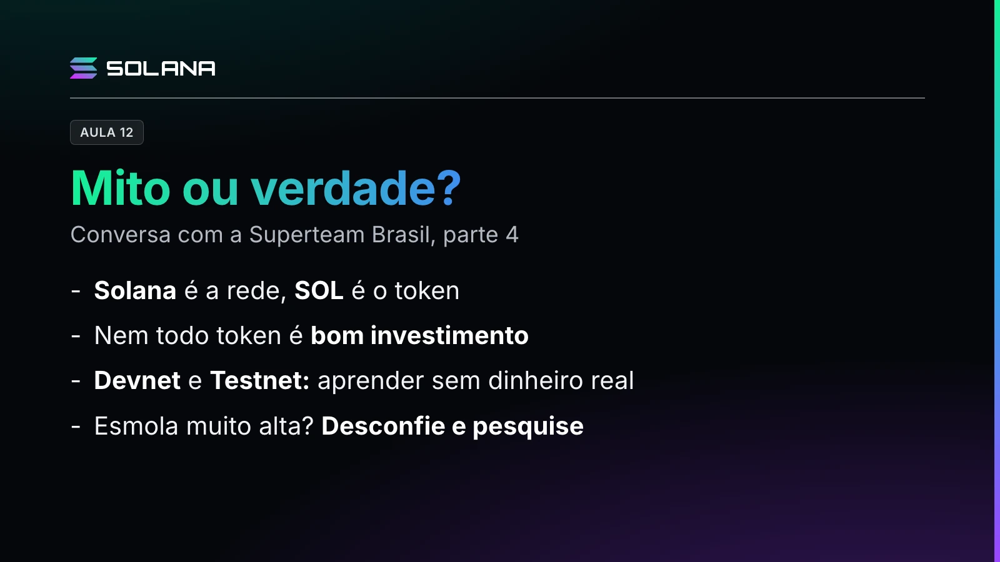

O professor fecha a conversa com uma rodada de mito ou verdade, em que Kuka e Kauê respondem a perguntas rápidas sobre a Solana, tokens, segurança e primeiros passos.

## Solana, SOL e investimento

- **Solana é só uma criptomoeda?** Mito. Solana é a blockchain, e SOL é o token usado para pagar as transações.
- **Preciso comprar SOL para começar?** Depende. Em regra, sim, para pagar as taxas, mas há iniciativas que subsidiam as primeiras transações.
- **Comprar SOL é ganhar dinheiro?** Não necessariamente. Os convidados dizem: "A gente não recomenda a compra direta de nenhum criptoativo". O preço oscila muito, e quem precisa vender para pagar uma conta pode vender na baixa.
- **Todo token criado na Solana é bom investimento?** Mito. Qualquer pessoa pode criar um token na rede, como as meme coins. Kauê lembra que nada substitui a própria pesquisa.

A frase da pauta: antes de investir um real, invista uma hora aprendendo como a rede funciona.

> **Nota editorial (25 de novembro de 2026).** Esta aula e o vídeo não são recomendação de investimento. Criptoativos são voláteis, inclusive os mais conhecidos, e é possível perder dinheiro.

## Como a rede funciona

- **Taxas:** para o usuário comum, Kuka diz que uma transação costuma custar menos de um centavo.
- **A rede fecha?** Não há horário: funciona à noite, em fins de semana e feriados. Kauê afirma que a última interrupção foi há cerca de três anos e que a disponibilidade supera a de grandes provedores de nuvem. São afirmações dele, e esses números mudam.
- **Stablecoins:** não são só para traders. Kuka usa para enviar dinheiro e pagar contas.

## Para aprender e construir

- **Precisa ser programador?** Não.
- **Dá para aprender sem dinheiro real?** Sim. Existem a Devnet e a Testnet, redes de teste.
- **Linguagens:** Kauê indica TypeScript para as aplicações e Rust para os programas que rodam on-chain.

## Staking e carteiras

- **Staking é igual a CDB?** Os convidados explicam: você deixa SOL com um validador e recebe um retorno. No vídeo, fala-se em algo em torno de 5% ao ano. É um valor aproximado, que varia, e é pago em SOL, cujo preço é volátil.
- **Carteira é igual a conta bancária?** Pode cumprir um papel parecido, mas na autocustódia o controle é seu. Kuka acha útil ter mais de uma.
- **Carteira física (hardware wallet):** o dispositivo guarda a chave privada, que nunca sai dali: só saem as assinaturas.

## Quando a esmola é muito alta

Promessa de rentabilidade muito alta pede desconfiança, e Kuka lembra golpes conhecidos no Brasil. O caminho é estudar o protocolo e a empresa antes de colocar dinheiro e perguntar a pessoas mais experientes.
