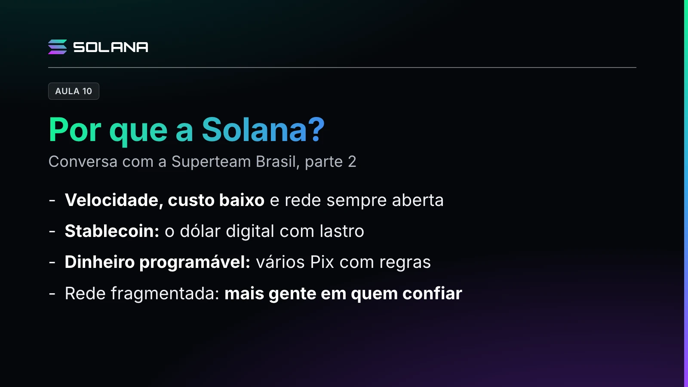

O professor pergunta a Kuka e Kauê por que velocidade, custo e funcionamento contínuo importam para uma instituição financeira, e a conversa passa por tokens, dinheiro programável, redes privadas e o caminho de uma pessoa até a blockchain.

## Velocidade, custo e rede sempre aberta

O professor observa que uma blockchain voltada ao mercado financeiro concorre com infraestrutura profissional: precisa de velocidade, baixo custo e funcionamento 24 horas por dia, 7 dias por semana. Ele cita blocos de cerca de 400 milissegundos. Kuka responde que a velocidade sozinha não decide: conta junto com o custo baixo e a confiabilidade.

> **Nota editorial (25 de novembro de 2026).** Os 400 milissegundos são o número citado na gravação. O tempo de bloco muda com as atualizações da rede e hoje é menor.

## Token, stablecoin e tokenização

- **Token:** Kuka explica como a versão digital de um ativo, registrada na blockchain.
- **Stablecoin:** uma moeda digital atrelada a um valor de referência, como o dólar. De forma simplificada, uma empresa recebe dólares, guarda em reserva e emite a mesma quantidade de dólares digitais.
- **Ativos tokenizados:** a mesma lógica vale para produtos financeiros. Uma instituição compra títulos públicos e emite um token para cada um, e o rendimento pode ser repassado automaticamente a quem detém o token.

## Dinheiro programável

Kauê propõe pensar em vários Pix, cada um com regras próprias gravadas no código: só completar se o destinatário estiver numa lista, recusar endereços bloqueados, limitar horário ou quantidade. Se as condições não forem cumpridas, a transação não acontece, não importa quantas vezes se tente.

## O que a primeira geração ensinou

O professor pergunta sobre as redes próprias em que bancos investiram, como Corda e Hyperledger, e sobre as L2. Kauê explica que a versão privada parecia o caminho mais fácil, mas traz de volta o problema da confiança: alguém mantém a rede, e os demais dependem dele. Para ele, as L2, redes de segunda camada construídas sobre outra blockchain, seguem lógica parecida: ao fragmentar uma rede, surgem novos participantes em quem é preciso confiar. Na avaliação de Kauê, essa fragmentação foi um erro.

A frase do professor resume: a primeira geração tentou colocar a blockchain dentro do banco, e a atual pode colocar o banco dentro de uma infraestrutura global.

## Como uma pessoa chega à blockchain

Kuka explica que a rede é aberta: ninguém precisa pedir permissão. Para interagir, por exemplo enviando tokens, é preciso uma carteira digital. Alguns aplicativos trazem a carteira embutida, e o usuário movimenta dólar digital sem saber. Para quem joga, ele compara com as skins: hoje a moeda de um jogo só vale dentro dele, e com blockchain poderia circular entre jogos.
