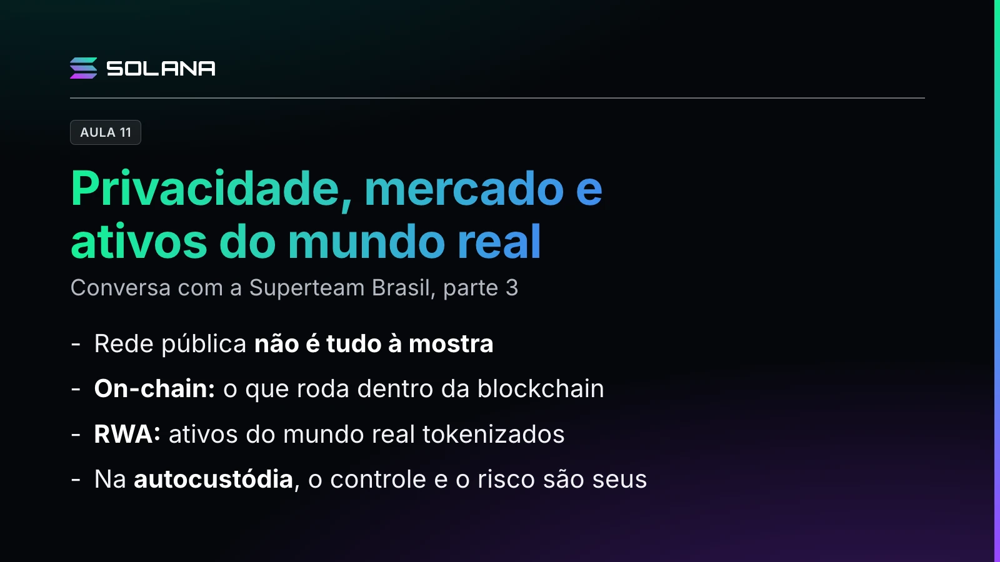

O professor leva a Kuka e Kauê a objeção que todo banco faz a uma rede pública, e a conversa segue por quem já usa a tecnologia, o que quer dizer on-chain, os ativos do mundo real e a autocustódia.

## Privacidade numa rede pública

Para o professor, as perguntas úteis são o que precisa ser privado, quem precisa enxergar e quem controla as regras.

Kuka parte do básico: por padrão, o que está na blockchain é público, um livro aberto. Por isso ele chama de mito a ideia de que ali nada se rastreia. O problema é o outro lado: uma empresa não quer expor seus pagamentos a concorrentes. Ele cita soluções na Solana, como ambientes privados conectados à rede principal. Kauê acrescenta que quem define o grau de privacidade é o desenvolvedor de cada aplicação: a rede segue pública, e a privacidade é construída na camada de aplicação.

## Quem já usa

O professor lista empresas de modelos diferentes: Visa, Stripe, PayPal, Western Union, JP Morgan, BlackRock e State Street. O ponto em comum, segundo ele: ativos digitais, regras programáveis e liquidação contínua. Sobre o tabu, Kuka responde que usar cripto não é crime e que stablecoin também é cripto: um dólar tokenizado.

> **Nota editorial (25 de novembro de 2026).** Esta aula e o vídeo não são orientação jurídica nem recomendação de investimento. Criptoativos são voláteis, e as regras do setor continuam mudando. Verifique as regras aplicáveis antes de operar.

## O que é on-chain

Kauê define: on-chain é o que roda dentro da blockchain, quando processamento, validação, armazenamento ou custódia acontecem diretamente nela. O que uma corretora centralizada faz por dentro, depois do depósito, não é on-chain.

## RWA: ativos do mundo real

RWA é a sigla de Real World Assets: ativos do mundo real tokenizados, como títulos públicos, ouro guardado em cofre e ações. Kuka destaca a liquidez: o ouro tokenizado pode ser vendido a preço de mercado em segundos. As ações tokenizadas são mais um caminho de acesso a empresas estrangeiras. Kauê lembra que entrar nesse mercado não exige começar pelo ativo de maior risco.

Segundo os números citados na aula, a Solana movimentou 4,7 trilhões de dólares em stablecoins em doze meses. O professor ressalva que volume movimentado não é dinheiro depositado.

## Autocustódia

Kuka compara guardar ativos na própria carteira com deixá-los numa instituição: na autocustódia, o controle é de quem tem as chaves.

> **Nota editorial (25 de novembro de 2026).** O vídeo afirma que é impossível bloquear ativos numa blockchain. Isso só vale, em sentido estrito, para ativos em autocustódia. Emissores de stablecoins e de ativos tokenizados podem congelar tokens, e as obrigações legais continuam valendo.
