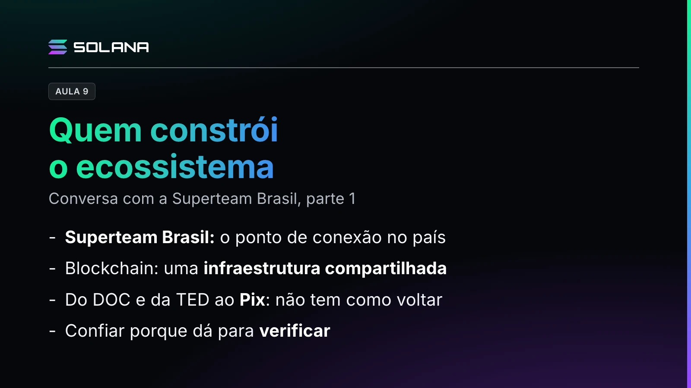

O professor recebe Pedro, o Kuka, e Kauê, da Superteam Brasil, para a primeira parte de uma conversa sobre a Solana: quem está construindo esse mercado e como explicar blockchain a quem nunca estudou o assunto.

## Quem constrói o ecossistema

O professor lembra que a nova infraestrutura financeira não nasce só em empresas de tecnologia: reúne desenvolvedores, empreendedores, bancos, investidores, universidades e comunidades. A Superteam Brasil é o ponto de conexão do ecossistema Solana no país e aproxima talentos, projetos e empresas com eventos, hackathons e formações.

- **Kuka** chegou às criptomoedas entre 2020 e 2021, pelas finanças descentralizadas (DeFi). Achou a primeira rede que conheceu cara e lenta e encontrou a Solana, primeiro como usuário. Em 2023 começou a construir e, em 2025, foi convidado a ajudar a Superteam Brasil.
- **Kauê** programa desde os 14 anos e veio da ciência de dados e da inteligência artificial. Para ele, o Bitcoin trouxe um dinheiro descentralizado, mas ainda não programável. Viu na blockchain uma tecnologia que dá ao usuário mais poder de verificar o que acontece.

## Blockchain explicada ao presidente de um banco

O professor propõe começar por uma definição, e não pela mineração ou pela criptografia: blockchain é uma infraestrutura em que diferentes participantes compartilham, movimentam e verificam ativos e informações, sem manter várias bases de dados desconectadas para conciliar depois.

Kuka responde pelo porquê. Para ele, é como perguntar, no começo da internet, por que um banco deveria usá-la: grandes instituições já adotam a tecnologia, e quem não se adaptar tende a ficar para trás. Ele cita as remessas internacionais, que pelo caminho tradicional levam dias e custam caro e que, numa blockchain como a Solana, chegam em segundos por uma taxa muito pequena.

## A analogia do Pix

O professor sugere a comparação e Kuka concorda. Antes do Pix havia a TED e o DOC: demoravam, às vezes falhavam, e a tarifa podia passar de 10 reais, o que tornava inviável pagar um salgado de 5 reais. Hoje o Pix é instantâneo e todo mundo usa. Kuka registra uma diferença: o Pix é centralizado. E conclui que quem se acostuma com a velocidade não volta à tecnologia antiga.

## Confiar porque dá para verificar

Kauê acrescenta o lado técnico: o que a blockchain resolve é a confiança. Se a rede fosse uma cópia no servidor de um único banco, todos os outros teriam de confiar nele. Numa rede pública e global, mantida por centenas de nós diferentes, o ambiente é igual para todos, transparente e auditável. Na frase dele, você confia porque não precisa confiar: consegue verificar.
