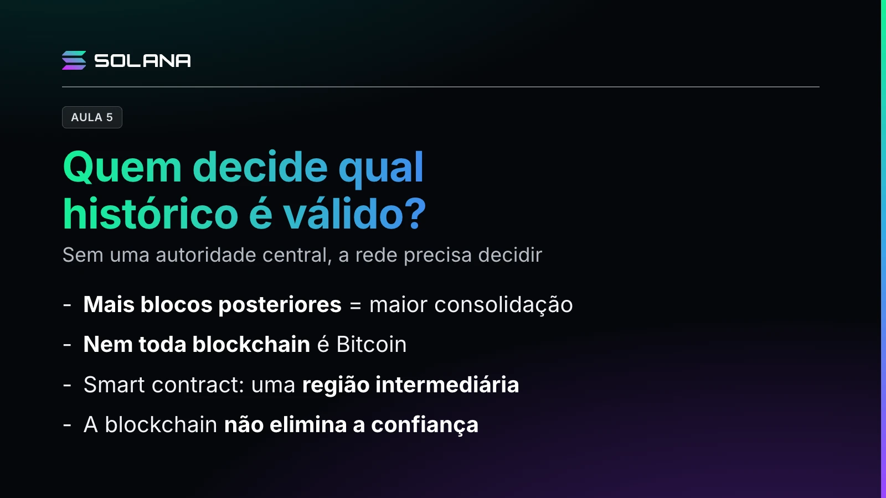

O professor mostra como uma rede sem autoridade central decide qual histórico é válido, e onde entra a Solana.

## Prova de trabalho e confirmações

No Bitcoin, os mineradores disputam o direito de propor um novo bloco com a Proof of Work (PoW), a prova de trabalho, que exige esforço computacional, e outros computadores, os nós, verificam se o bloco respeita o protocolo. Entre históricos concorrentes, a rede tende a reconhecer o de maior trabalho acumulado.

Uma transferência registrada no bloco N ganha a primeira, a segunda e a terceira confirmação nos blocos N+1, N+2 e N+3. Guarde essa regra: mais blocos posteriores é igual a uma maior consolidação.

Três termos que costumam confundir:

- **Blockchain:** uma estrutura de registros em blocos conectados criptograficamente.
- **Bitcoin**, com maiúscula: a rede e o protocolo de um sistema de dinheiro eletrônico descentralizado.
- **bitcoin**, com minúscula: a unidade monetária, o BTC.

A frase de efeito: o Bitcoin utiliza uma blockchain, mas nem toda blockchain é Bitcoin.

## Smart contracts: a região intermediária

Na compra de um carro, quem dá primeiro, o dinheiro ou o carro? O smart contract cria uma região intermediária: o comprador deposita o dinheiro, mas o vendedor não recebe nada até as condições serem atendidas, e quem transfere o carro também não o entrega direto à outra pessoa. Quando os dois lados cumprem a regra, o programa executa a venda.

## O surgimento da Solana

Com o crescimento das aplicações vieram congestionamentos, demora na confirmação e aumento das taxas. Anatoly Yakovenko começou a desenvolver a Solana, uma blockchain programável de alto desempenho, em 2017, e a rede principal entrou em funcionamento em 2020. Na cidade digital, ela é uma nova região planejada, com vias de grande capacidade e sistemas sincronizados.

- **Proof of Stake (PoS):** validadores usam SOL recebido em delegação ou colocado em participação para colaborar com a segurança da rede.
- **Proof of History (PoH):** a Solana também nasceu com ela. A PoH não é o consenso: é uma sequência criptográfica que ajuda a comprovar a ordem e a passagem do tempo entre os eventos.

> **Nota editorial (2 de novembro de 2026).** O vídeo descreve o desenho com que a Solana foi lançada. Desde a época 1064, em 21 de outubro de 2026, a rede principal usa o Alpenglow, que mudou a forma como a rede vota e finaliza blocos e substituiu a Proof of History, conforme as propostas SIMD-0326 e SIMD-0384.

Por fim, a descentralização é um espectro. A blockchain não elimina a confiança: modifica a maneira como ela é construída, distribuída e verificada.
