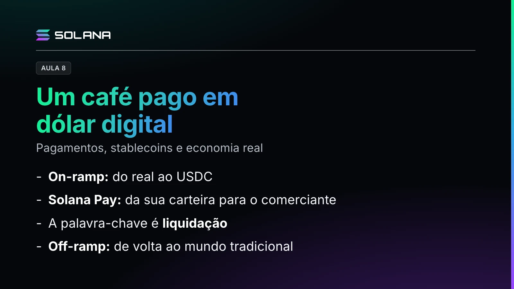

O professor parte de uma cafeteria com a plaquinha "Aceitamos USDC, dólar digital, pela Solana" para mostrar o caminho de um pagamento com stablecoin, do real até o comerciante e de volta.

## Do real ao pagamento

- **USDC:** um token que busca acompanhar o dólar. Você usa uma carteira digital para transferi-lo ao comerciante, como faz hoje com o Pix.
- **On-ramp:** se você ainda não tem USDC, usa um fornecedor para trazer dinheiro do mundo tradicional para o mundo cripto. Confira as taxas e a cotação para sair de real e chegar em USDC.
- **Endereço:** para o USDC chegar à sua carteira, você informa o seu endereço, como uma chave Pix. Depois, confira se o valor que saiu em real virou o USDC esperado, considerando as taxas de serviço.
- **Solana Pay:** como encostar o celular na maquininha, o Solana Pay transfere o valor da sua carteira para o comerciante. Cuidado: a transferência é feita com o token USDC, então o comerciante recebe dólar digital, em USDC, e não reais. É o que a plaquinha dizia.
- **Destino:** um QR Code, como no Pix, direciona o valor para a conta certa.

## A palavra-chave é liquidação

Você só tem certeza de que a transação ocorreu quando a liquidação da operação acontece. É aquele barulhinho da máquina de cartão, "transação feita".

## O off-ramp e o dólar digital que circula

Com o USDC em mãos, o comerciante pode fazer o off-ramp: sair do mundo cripto e voltar para as finanças tradicionais, convertendo para a moeda local. Mas nem sempre precisa converter. Se compra café importado, pode pagar o fornecedor em USDC, e o fornecedor pode usar essa moeda nas suas próprias transações. Algum fornecedor também pode aceitar SOL, com que se pagam as taxas da rede.

> **Nota editorial (2 de novembro de 2026).** Esta aula e o vídeo não são orientação jurídica. No Brasil, regras do Banco Central, como a Res BCB 521 e a Res BCB 561, podem se aplicar a pagamentos com stablecoins e a fluxos internacionais. Comerciantes e importadores devem verificar as regras aplicáveis antes de operar.
