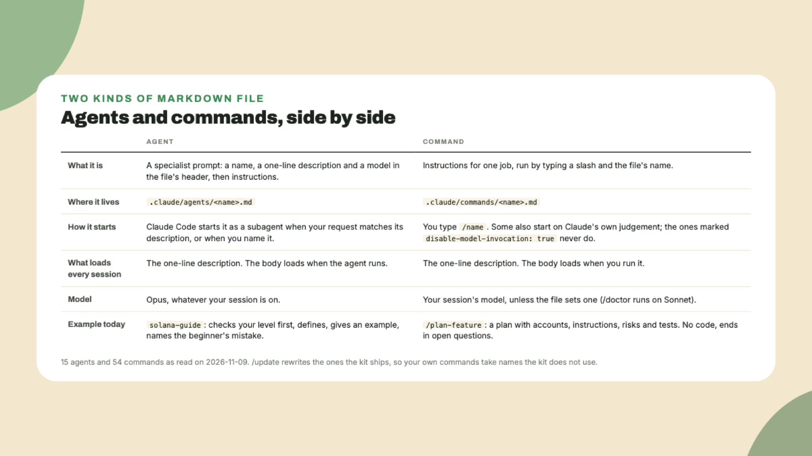

# Agents and commands

Last lesson Claude named one file without reading it. This lesson it does real work: one agent explains something at your level, and **one command writes a plan** for a small program. Neither needs a toolchain.

## Why this matters

Both things are markdown files, and knowing that removes most of the mystery. **An agent** is a file in `.claude/agents/` with a name, a one-line description and a model. Claude Code starts it as a subagent when your request matches the description, or when you name it. **A command** is a file in `.claude/commands/`, and you run it by typing a slash and its name. The body of the file is the instructions Claude follows. Only the one-line descriptions load in every session, *so having 15 agents and 54 commands on disk costs almost nothing until you use one*.

## Do this

1. **List both folders.**

```bash
ls .claude/agents .claude/commands
```

Fifteen agents, as read on 2026-11-09: an architect, an Anchor engineer, a Pinocchio engineer for compute-optimized programs, engineers for DeFi, tokens, frontend, mobile, Rust backends, DevOps, QA, Unity and games, a docs writer, a researcher, and **solana-guide**, the one for learning. Every one of them runs on **Opus**, whatever model your session is on. The commands folder has 54 files, five of them short names for longer commands.

2. **Read one agent end to end.**

```bash
cat .claude/agents/solana-guide.md
```

It is short. The part to notice is *how it teaches*: it checks your level first and asks rather than assumes, it gives a plain definition and the problem the concept solves, then an example, then the mistake beginners make, and it checks your understanding before moving on. The references at the bottom point into the solana-dev pack, which is where its example code comes from.



3. **Use the agent.** Type this inside Claude Code:

```text
Use the solana-guide agent to explain what a program derived address is. I know JavaScript and nothing about Solana.
```

Naming the agent is deliberate. Claude also starts agents on its own when a request matches a description, but **naming one removes the guess**. You should see the agent start in the transcript, then either a question about your goal or an explanation in the shape the file described. If it skips the beginner's mistake, ask for it.

4. **Run a command that plans.** Type:

```text
/plan-feature a tip jar: anyone can send devnet SOL to a creator, and the program counts how many tips each creator received
```

The command's file says **plan only, write no code**. Expect it to ask one or two questions that change the design, such as who pays rent for the counter account, and to bring in the solana-architect agent if the account model is open. Then it writes a plan with a fixed shape: summary, accounts with their seeds and sizes, instructions, integrations, clients, phases, risks, tests and rollout, ending in **open questions for you**. Read the accounts section and the risks section. The rollout line will say devnet first through `/deploy`, and that order is a house rule from `CLAUDE.md`, not a suggestion.

5. **Know which commands only you can run.** Open `.claude/commands/firewall.md` and look at the second field of its header: `disable-model-invocation: true`. Commands with that line never start on Claude's own judgement. `/ship`, `/update`, `/add-skill`, `/firewall`, `/parallel` and `/adversarial` carry it, because *each one either multiplies agents or changes something you should decide yourself*.

## Done when

- The transcript shows the solana-guide agent starting and finishing.
- You hold a written plan for the tip jar with no code in it, and at least one open question at the end.
- You can point at the line that makes a command yours alone to run.

## Watch out

- **Kit-owned files get refreshed.** `/update` rewrites the agents, commands, skills and `bin/` scripts the kit ships. If you want a command of your own, give it **a name the kit does not use**, and it survives every update.
- **An agent runs on the strongest model**, regardless of your session setting, and that costs more per call. For a quick question, ask the main session. For design and code, let the agent run.
- **A plan is not a scaffold.** `/scaffold` creates a project with the kit installed, `/build-program` builds one, `/deploy` deploys one. Today you ran none of those, and I would keep it that way until the Rust toolchain is on your machine.

## The takeaway

An agent is a specialist prompt that starts on a description match or on its name, and a command is a markdown file you run with a slash, **both readable and both cheap until used**. The kit's own files get rewritten by updates, *so your additions live under names of your own*.

## Next

Next lesson is the one the workshop is built around: Claude writes and runs a small script that reads a devnet balance with the current Solana client library, and you watch which file it reads first. Have a terminal and around twenty minutes.
