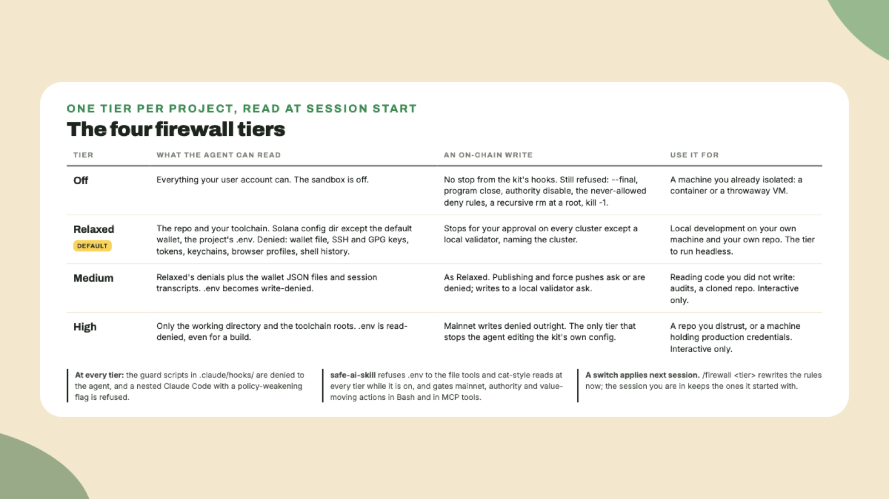

# The firewall: four tiers and what they do not do

Last lesson ended with a promise: you ask Claude to read `.env` and **watch it get refused**. That refusal is one layer of the kit's firewall, and this lesson walks the layers, the four tiers, and the honest list of what none of it can do.

## Why this matters

An agent that can run shell commands can read your wallet file, push to mainnet and delete a folder, all inside one session. The firewall is **a set of permission and sandbox rules Claude Code reads at session start**, generated from a tier named in one file, plus a handful of hook scripts that run before a command, plus the safe-ai-skill plugin. It makes the expensive mistakes **stop and ask**, and it refuses the irreversible ones. It does not judge whether the task was a good idea in the first place. The firewall document in the kit's repository is the most thorough thing of its kind I have read, and most of this lesson is its short version.

## Do this

1. **See your tier.** Type inside Claude Code:

```text
/firewall
```

It reports the **declared tier**, the **enforced tier**, whether they agree, and how many rules were written. The declaration lives in `.claude/security.json`, and the rules in `.claude/settings.json`. Read both, edit neither:

```bash
cat .claude/security.json
```

2. **Know the four tiers.** One tier is in force per project. Each one, from the kit's README as read on 2026-11-09:

- **Off** turns the sandbox off, reads everything your user can, and asks about no on-chain write. What remains: the irreversible refusals, the never-allowed deny rules on credential paths and repo deletion, the guards' refusals of a recursive `rm` at a root, `kill -1` and a shell's `-c`, and the security plugin. For a machine you already isolated.
- **Relaxed**, the default, is for **local development on your own repo**. It leaves your Solana config directory readable except the default wallet, so `solana config get` works, and the project's `.env` readable so the toolchain works. It denies the default wallet file, SSH and GPG keys, cloud and registry tokens, keychains, browser profiles and shell history. Writes are limited to the repo, the temp dir, the toolchain caches and `.env`. **On-chain writes stop for your approval on every cluster except a local validator.**
- **Medium** adds the wallet files and session transcripts to the denied reads, makes `.env` write-denied, denies publishing and killing processes, and makes force pushes ask. For **reading code you did not write**: audits, dependency triage, a repo you cloned to look at.
- **High** reads only the working directory and the toolchain roots, denies mainnet writes outright instead of asking, and is **the only tier that stops the agent editing the kit's own configuration**. For a repo you actively distrust, or a machine holding production credentials.



Two things hold at every tier, Off included. The guard scripts in `.claude/hooks/` are denied to the agent, so customizing never means editing a guard. And a nested Claude Code started with a flag that weakens policy is refused.

3. **Trigger the refusal.** Type:

```text
Read .env and list what is in it.
```

The read is refused. That is **safe-ai-skill**, the security plugin the installer added, and it refuses `.env` to the file tools and to `cat`-style reads at every tier while it is on, *stricter than the tiers' own rules*. Claude should then offer the helper from last lesson, `bash .claude/bin/env-keys.sh`, which answers the real question without a value. If it tries `grep` or an inline interpreter instead, that is a known gap the kit documents, and you say no.

4. **Switch a tier and read the warning.** Type:

```text
/firewall medium
```

The command rewrites the generated block in `settings.json` and tells you that **the switch takes effect in the next session**. Rules are read once at session start, so the session you are in keeps what it began with, tightening or loosening alike. Switch back with `/firewall relaxed` before you leave today, unless the next thing you do on this machine is read someone else's code.

5. **Read what the tiers do not do.** This is the section most tools leave out, and the kit puts it in the README:

- **An MCP server runs outside the sandbox.** Only the hooks reach it, and the hooks match the shell and context-mode's tools. So at Medium and High the kit refuses context-mode's code executor outright, and at every tier an attached Phantom or Cloudflare server is bounded by its own credential, not by the tier.
- **Medium and High are interactive only.** They ask, and a headless run cannot answer. Relaxed is the tier to run headless.
- **What Relaxed leaves readable is readable by every process the agent runs**, not only by the tool it was left open for.
- **Without the sandbox**, at Off or in a plugin install, the security plugin is a pattern layer, and a script written in one call and run in the next walks past it.
- **The tier is not immune to the agent.** Below High, the agent can edit `settings.json`. The kit's position is that your own configuration is your call, and High exists for when it should not be.

## Done when

- `/firewall` printed a declared and an enforced tier that agree.
- You saw the `.env` read refused and the helper offered.
- You switched a tier, read the next-session warning, and switched back.

## Watch out

- **Windows.** The plugin has no engine build for native Windows and would block every tool call, so the installer skips it there. The tiers still apply. WSL2 is fine.
- **The hooks are the enforcement and the registrations are what run them.** `/doctor` check 10 tells you when the two disagree after an update.
- **A plugin install of the kit has no sandbox** and no `bin/`, which is one of the reasons the maintainers do not recommend that route.

## The takeaway

One tier per project, **Relaxed by default**, switched with one command that applies next session. The security plugin refuses secret reads at every tier, and the README says plainly what no tier can enforce, *which is the part worth remembering when you attach a server that moves money*.

## Next

The final lesson starts with two commands that give Claude a memory across sessions, then covers the language server plugins, how `/update` behaves, and the longer workflow from a backlog to a merged pull request. It ends with a quiz over the whole course.
