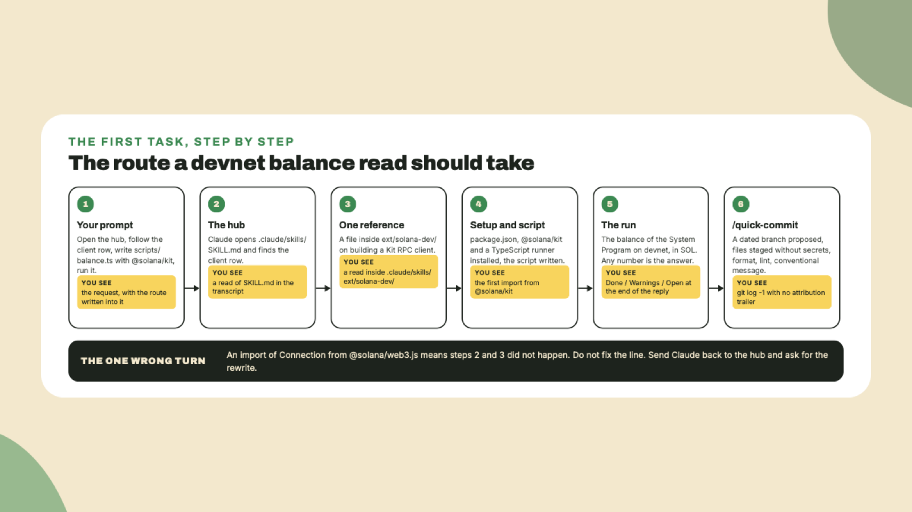

# Your first Solana task through the kit

Last lesson a command wrote a plan with no code in it. Now Claude **writes and runs code**, a script that reads a devnet balance, and you watch the route it takes to get there. Around twenty minutes.

## Why this matters

The task is deliberately small: read the SOL balance of one address on devnet and print it. Any model can do that from memory, and *that is exactly the trap*. From memory it reaches for the client library it saw most in training, which is the old one. Through the kit it opens the hub, follows the client row into the Foundation's solana-dev reference, and writes the current library, `@solana/kit`. What you are checking is **the file it read first**, more than the number it prints.

## Do this

1. **Give the task, with the route in it.** Type this inside Claude Code:

```text
Before writing anything, open .claude/skills/SKILL.md and follow the row for client work into its reference. Then write scripts/balance.ts, a TypeScript script that prints the devnet SOL balance of the address 11111111111111111111111111111111 using @solana/kit, set up whatever this empty project needs to run it, and run it.
```

The address is the System Program, which exists on every cluster, so the read works without a wallet, a key or an airdrop. Whatever number it prints is the answer. *Zero would be an answer too.*

2. **Watch the route.** In the transcript you should see, in this order: the hub opened, one reference inside `.claude/skills/ext/solana-dev/` opened, a `package.json` created, `@solana/kit` installed along with a TypeScript runner, the script written, the script run. The script itself should build an RPC client from the Kit library, call the balance method for that address, and divide lamports into SOL before printing.



3. **Check for the one wrong turn.** Open `scripts/balance.ts`. If the first line imports `Connection` from `@solana/web3.js`, Claude wrote from memory and skipped the hub. Say so:

```text
That import is the legacy library. Open .claude/skills/SKILL.md, read the client reference it points to, and rewrite the script with @solana/kit.
```

Do not fix the import yourself. **The correction you want is in Claude's behaviour**, and the rewrite is how you see that the route works when it is followed.

4. **Read how the reply ends.** The kit's `CLAUDE.md` asks Claude to close every main-session reply with three labelled lines where they apply: **Done**, what landed, **Warnings**, what broke or needs watching, and **Open**, what still needs your answer. A reply that ends that way is the house rule working.

5. **Commit with the kit.** Type:

```text
/quick-commit
```

On `main` it first proposes a branch in the kit's shape, `feat/scripts-balance-09-11-2026` with today's date, and asks whether to create it, name it yourself, or stay. Create it. Then it stages the files while leaving out `.env`, keypairs and `node_modules`, formats, lints, writes a conventional message from the staged diff, and commits. **No AI attribution trailer**, because the kit sets that to empty in its settings. Check with `git log -1`.

6. **Picture the program path you did not take.** With Rust and Anchor installed, the same session would run `/scaffold` for an Anchor project, `/build-program`, `/test-rust`, and `/deploy devnet`. The deploy command and the house rules agree on one thing you should hear now: **devnet first, and mainnet needs your explicit go-ahead every time**. The firewall adds a stop of its own on on-chain writes to any cluster but a local validator, which lesson 7 covers.

## Done when

- The script printed a balance for the System Program on devnet.
- The first import in `scripts/balance.ts` is from `@solana/kit`.
- `git log -1` shows a conventional commit on a dated branch with no attribution trailer.

## Watch out

- **The public devnet endpoint is rate limited.** For one read it is fine. For anything that polls, that is what the Helius key in the next lesson is for.
- **Nothing you did needed `.env`.** If Claude asks for an RPC key to read one public balance, say no and let it use the public endpoint.
- **Node version.** If the install of the dependencies fails on an engine check, your Node is older than the packages want. Lesson 1 asked for 22 or newer for a reason.
- **Run things, do not just read them.** A script that was written and never executed proves nothing. The run is part of the task you gave.

## The takeaway

The kit's value is the file read **before** the code, and a stale import is how you know it was skipped. The commit command gives you a dated branch and a clean message, *and your reply ends with what landed and what is open because the house rules asked for it*.

## Next

Next lesson you open `.mcp.json`, see the four servers Claude Code asked you to approve, and ask the Solana docs server a question so you can see a tool call happen. You will also learn where a key goes, and where it never goes.
