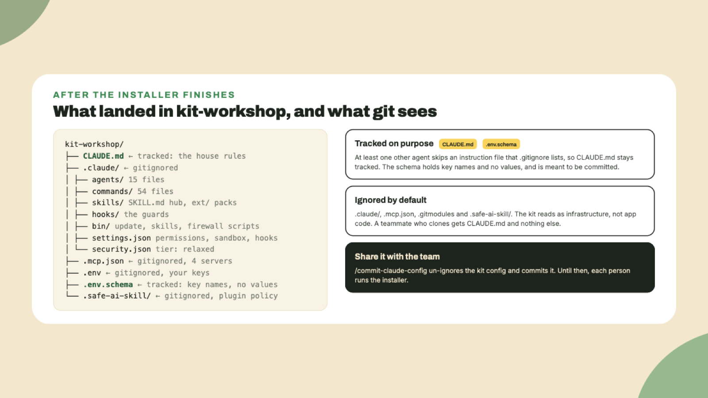

# Install it into a project

Last lesson you created an empty folder and checked that `claude --version` prints something. This lesson puts the kit inside that folder and ends with **a health report of thirteen lines**. It takes around fifteen minutes, and most of that is reading.

## Why this matters

The installer is a shell script fetched over the network and piped into `bash`. That shape is common, and *most people run it without looking*. The kit's own README asks you not to, and I agree with it: the review step costs two minutes. So the three commands below download the script, show it to you, and only then run **the copy you read**.

## Do this

1. **Go into the folder and make it a repository.** The installer installs into the directory it runs in, so this `cd` is the step people skip and then wonder where the kit went.

```bash
cd kit-workshop
```

```bash
git init
```

2. **Download the installer and read it.** The address redirects to the script on the kit's `main` branch. Press `q` to leave the reader when you are done.

```bash
curl -fsSL https://aikit.superteam.codes/install.sh -o /tmp/solana-ai-kit-install.sh
```

```bash
less /tmp/solana-ai-kit-install.sh
```

You are reading for **four things**: it downloads the kit's latest release tag into a temporary directory and deletes it afterwards, it copies named folders and a handful of root files into your project, it adds lines to your `.gitignore`, and near the end it runs `claude plugin install safe-ai-skill@stbr --scope project` to install the security plugin. *It asks you nothing while it runs.* One more check before you run it, from the kit's own install doc: the script clones whatever repository `SOLANA_AI_KIT_UPSTREAM` names if that variable is set in your shell, so make sure it is not:

```bash
env | grep _UPSTREAM
```

3. **Run the copy you read.**

```bash
bash /tmp/solana-ai-kit-install.sh
```

4. **Read the closing box.** It starts with *Installation complete* and then lists the next steps, the firewall tier you are on (**Relaxed**), whether the security plugin was installed, and which paths were gitignored. If the box says safe-ai-skill is *enabled but not installed*, it prints the one command to run, and you run it now.

5. **Look at what landed.** The project now carries `CLAUDE.md`, `.claude/`, `.mcp.json`, `.env`, `.env.schema` and `.safe-ai-skill/`. Inside `.claude/` are `agents/`, `commands/`, `skills/`, `hooks/`, `bin/`, a `settings.json` with the permission and sandbox rules, and a `security.json` that names the tier those rules came from.



The kit's folders are gitignored by default, and so are `.mcp.json`, `.env` and `.safe-ai-skill/`. Two files stay tracked on purpose. `CLAUDE.md` does because at least one other agent skips an instruction file that `.gitignore` lists, and `.env.schema` does because it holds key names with no values and is meant to be committed. The kit reads as infrastructure, not as your app code. When a team should share one configuration, `/commit-claude-config` un-ignores the lot and commits it.

6. **Start Claude Code.**

```bash
claude
```

Claude Code asks **once per project** whether to start the four MCP servers it found in `.mcp.json`. Approve them. Helius is listed but useless until a key is set, which is fine for today.

7. **Run the health check.** Type this inside Claude Code:

```text
/doctor
```

It runs **thirteen checks**, each marked OK, WARN, FAIL or n/a, with one fix-it command next to every failure. On a machine set up as last lesson asked, expect the Solana CLI line to read FAIL with its install command, a note or two about keys that are still empty, and the firewall and safe-ai-skill lines to read OK. *Read the whole report once*, because the shape of it is what you come back to when something breaks in a month.

## Done when

- `ls -a` in the project shows `CLAUDE.md`, `.claude`, `.mcp.json` and `.env`.
- `cat .claude/security.json` names the tier **relaxed**.
- `/doctor` ran, and the only FAIL is the Solana CLI, or there is none.

## Watch out

- **Run it from the project root.** The installer has no idea which folder you meant. It installs where it stands.
- **Flags you did not use today.** `--agents` installs into `.agents/` with an `AGENTS.md` for Codex, opencode and other tools that read that file. `--with sendai,jupiter` adds skill extensions at install time. `--tier=medium` starts on a stricter firewall tier. The script's first lines document all of them.
- **The plugin marketplace route exists and the kit does not recommend it.** A plugin runs hooks and MCP servers with your user permissions and can update from a remote. The install you just did is the one the maintainers stand behind.

## The takeaway

The kit is installed by a script you read first, into the folder you ran it from, and **the health check is how you confirm it**. Everything it added is ignored by git except `CLAUDE.md` and the key schema, *so a teammate gets nothing until they install too or you commit the config*.

## Next

Next lesson you open one file, `.claude/skills/SKILL.md`, and read its first table. That file is the reason Claude will know which Solana reference to read before it writes anything.
