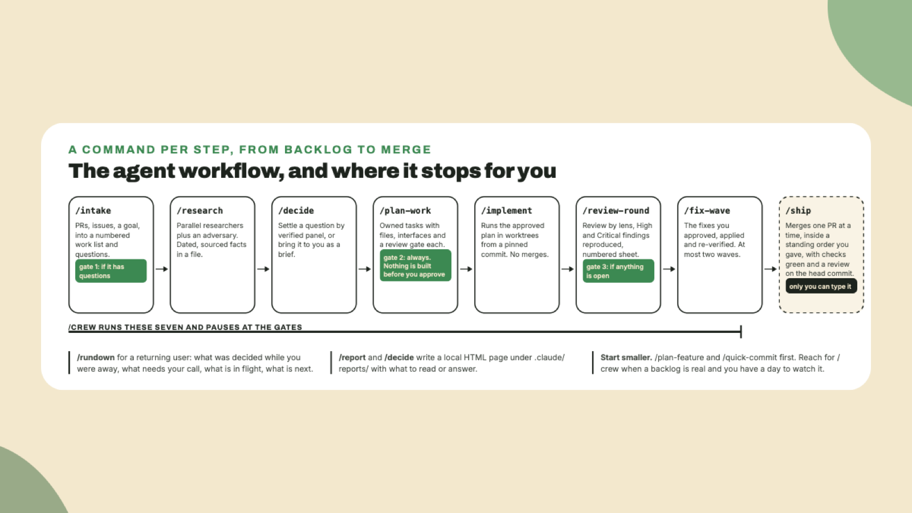

# Memory, updates and the longer workflow

You installed the kit, routed a task through the hub, ran an agent and a command, read a balance with the current client library, set a key and watched the firewall refuse a read. This lesson is **what to add after the workshop** and what to know before you update the kit, and then a quiz over the whole course.

## Why this matters

A Solana project collects context that is expensive to rediscover: which program id is live on which cluster, the account layout you settled on and the reason you rejected the other one, the approach that failed. Without memory every session starts cold and the agent re-derives it, re-asks you, or *quietly re-makes a decision you already threw out*. And the kit itself moves between workshops, so knowing how `/update` behaves is what keeps your install from drifting.

## Do this

1. **Add memory.** Two commands inside Claude Code, then a restart:

```text
/plugin marketplace add zilliztech/memsearch
```

```text
/plugin install memsearch
```

memsearch is a Claude Code plugin, not an MCP server. Its store is a local database file and its embedder runs on your CPU, so there is **no key and no account**. The one real cost is a model download of around 558 MB on first launch. After a few conversations, daily markdown files appear under `.memsearch/memory/` in the project, and *those files are the memory*, readable and editable by you. Recall is `/memory-recall <question>`, or simply asking something that needs history. It runs at Off and Relaxed. At Medium and High its set-up line meets a deny rule and recall stops.

2. **Add a compiler's view of your code.** The three language server plugins let Claude ask the compiler for a definition, every reference and a real type, instead of matching text. Install the server for each language you write first, since Claude Code offers the plugin once the binary is on your path. For TypeScript that is `npm i -g typescript typescript-language-server`, then:

```text
/plugin install typescript-lsp@claude-plugins-official
```

Rust gets `rust-analyzer-lsp` after `rustup component add rust-analyzer`. These cost nothing in a session when idle. *Install only the ones whose language you write.*

3. **Know what `/update` does.** It pulls the newest kit release tag, the same one a fresh install gets, and refreshes the agents, commands, skills and `bin/` scripts the kit ships. It **keeps your `.env` and your `CLAUDE.md`**, and when the kit's own instruction file changed it writes the new one beside yours as `CLAUDE.md.upstream` for you to merge. It re-applies your declared firewall tier, so restart Claude Code afterwards. Your own commands under names the kit does not use are left alone, and so are the extensions you installed, which it refreshes to the commits the new release records.

4. **Consolidate what the project learned.** Over weeks, `MEMORY.md` and the Project Learnings section of `CLAUDE.md` collect duplicates and contradictions. `/dream` merges, resolves and prunes them, adding nothing new, and asks before it touches the instruction file.

5. **Read the longer workflow once.** The kit has a command per step from a backlog to a merge, and **`/crew`** chains them:

```text
/intake → /research → /decide → /plan-work → /implement → /review-round → /fix-wave → /ship
```

`/crew` runs the first seven and stops at your gates: after intake when it has questions, **always at the plan**, so nothing is built before you approve it, after the review round when the sheet holds anything to answer, and always before shipping. **`/ship` is yours alone to type**, and it merges one pull request at a time, inside a standing order you gave, once every check passed and a review covers the head commit. `/rundown` tells a returning user what was decided while they were away and what needs their call. `/report` and `/decide` put what you need to read or answer on a local HTML page under `.claude/reports/`.



I would not start with `/crew`. Start with `/plan-feature` and `/quick-commit`, the two you already ran, and reach for the chain when a backlog is real and you have a day to watch it work.

6. **Know where to read.** The repository's `docs/` folder is never copied into your project, and it is where the long answers live: `install.md` for every install route, `firewall.md` for the tiers and their limits, `agents-and-commands.md` for all 15 agents and 54 commands, `skill-packs.md` for the pinned packs, and `configuration.md` for every MCP server and plugin with what each costs per session. `QUICK-START.md` is the two-minute version. The website at [kit.superteam.codes](https://kit.superteam.codes) is where the skills themselves are hosted.

## Done when

- memsearch is installed and Claude Code was restarted.
- You know which two files `/update` keeps and which one it writes beside yours.
- You can name the gate where `/crew` always stops.

## Watch out

- **Restart after memsearch and after `/update`.** Plugins activate on restart, and permission rules are read at session start.
- **A fifth plugin is not free.** Before adding any plugin, check whether it ships a hook that runs every session, and read what its descriptions cost. The configuration doc measured the popular ones.
- **The kit's dated facts go stale.** Counts, versions and prices in this course were read on 2026-11-09 at kit version 2.4.0. When the kit's README and this lesson disagree, *the README is right*.

## The takeaway

Memory and a compiler's view are the two additions that change how the kit feels day to day, and both run locally. `/update` keeps your `.env` and your instruction file, **and the longer workflow stops at the plan and before the ship**, so the agent never builds or merges what you did not approve.

Build something small with it this week, and tell the people who ran your workshop what the kit got right and what it got wrong. The kit's issues page on GitHub is where that feedback belongs.
