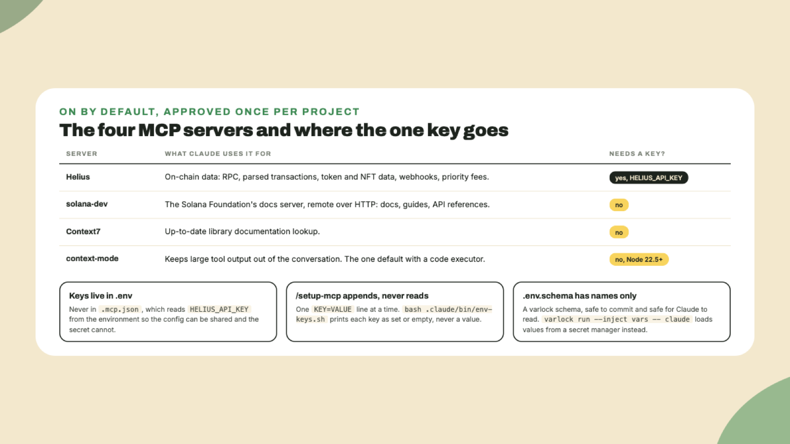

# MCP servers and where keys go

Last lesson's script read a public devnet endpoint and needed no key. Back in lesson 2, when you first started Claude Code, it asked you to approve four servers. This lesson is about what those are, which one needs a key, and **where that key goes**.

## Why this matters

An MCP server is **a small program Claude Code talks to in order to use tools it does not have on its own**: looking up a balance, searching documentation, keeping a big output out of the conversation. The kit turns four on by default and offers a handful more you can add. Most of them are harmless to attach. Two or three of them can move money or change a production database, *and the difference between them is not visible from the tool count*. So the habit this lesson teaches is to read what a server reaches before you attach it, and to keep every key in one file.

## Do this

1. **Read the server list.**

```bash
cat .mcp.json
```

Four entries, as read on 2026-11-09. **Helius** runs through `npx` and reads `HELIUS_API_KEY` from the environment, for on-chain data, parsed transactions, webhooks and priority fees. **solana-dev** is the Solana Foundation's docs server, remote over HTTP, with no key. **Context7** looks up library documentation, no key. **context-mode** keeps large tool output out of the context window, no key, and it is the one default server with a code executor, which is why the firewall has an opinion about it in the next lesson. Claude Code asked you about these **once**, and it will not ask again for this project.



2. **See a tool call happen.** Type this inside Claude Code:

```text
Using the solana-dev MCP server, find what the Solana docs say the rent-exempt minimum for an account depends on, and tell me which page you read.
```

In the transcript you should see a tool call to the solana-dev server before the answer. The answer should name account size as what the minimum depends on, and cite a docs page. You are watching for the call more than for the fact. If Claude answers from memory with no call, ask it to use the server.

3. **Know where the keys live.** Keys go in `.env`. Never in `.mcp.json`, never in a command file, never in the chat if you can help it. The install wrote `.env` from a template and `.env.schema` beside it, a schema listing every key's name and purpose with **no values**, so it is safe to commit and safe for Claude to read. Check what is set by name only:

```bash
bash .claude/bin/env-keys.sh
```

It prints one line per key, `set` or `empty`, and never a value. That script exists because the security plugin refuses to let Claude read `.env` at all, which lesson 7 shows you.

4. **Set the Helius key if you have one, or skip.** A free Helius account gives you a key from its dashboard. Then type:

```text
/setup-mcp
```

The command walks the keys one by one, asks you to paste a value or say skip, and **appends** the line to `.env`. It never reads the file back and never echoes a value. The value does pass through the chat once, which is why the kit recommends **varlock** for keys you care about: `.env.schema` is already a varlock schema, and `varlock run --inject vars -- claude` starts Claude Code with the values loaded from a secret manager instead of a plaintext file. Nothing breaks if you skip varlock. Today, skipping the key is fine too.

5. **Read the opt-in list before you ever add one.** The same command offers the optional servers. Three of them deserve a sentence each, taken from the kit's own configuration doc:

- **Supabase** is offered first in its read-only, project-scoped form. Those two URL parameters hide the write tools and drop cross-project reach. Drop them and `execute_sql` becomes an unrestricted SQL channel into your app's database.
- **Cloudflare** reaches its whole API through three tools, and one of them, `execute`, reaches every endpoint your token does. The lever is the token's scope, so make it narrow.
- **Phantom** is the one server that acts on funds rather than reporting on them. Its sign and send tools land signed transactions, and around a dozen more move real money. The kit's hooks do not reach MCP servers, so the boundary is *whatever the logged-in wallet holds*. Fund it accordingly.

You add none of these today. The point is to have read the list once **before** the day you need one.

## Done when

- You saw one tool call to the solana-dev server in the transcript.
- `env-keys.sh` prints every key by name with `set` or `empty`.
- You can say which of the four defaults needs a key, and which file it goes in.

## Watch out

- **Chainstack lists every tool whether or not it has a key**, so a keyless install looks complete and fails on the call. Nansen answers nothing without a paid key and loads around fifty tool schemas into every session it is attached to.
- **context-mode wants Node 22.5 or newer.** If that server failed to start when you approved it, that is why.
- **A key in the chat is a key in the transcript.** Paste once through `/setup-mcp` if you must, or use varlock and never paste at all.

## The takeaway

Four servers are on by default and **three need no key**. Keys live in `.env`, the schema beside it carries names only, and a helper reads presence without values, *so the agent can know a key is set without ever seeing it*.

## Next

Next lesson you ask Claude to read `.env` and watch it get refused. That refusal is the security plugin, and the lesson explains the four firewall tiers behind it, including what they cannot do.
