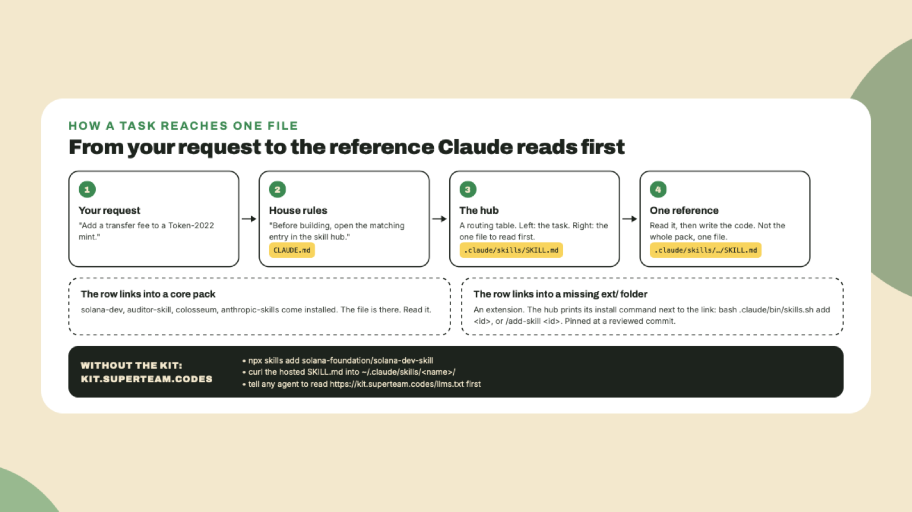

# Skills: what Claude reads before it works

The health report from last lesson had a line about skill packs. This lesson is about what those packs are and how Claude finds the right one, and it ends with you **asking Claude to name a file without reading it**.

## Why this matters

A skill is **a markdown file Claude reads before it does a task**. That is all a skill is. The Solana ecosystem moves faster than any model's training data, so a model left alone writes last year's client library and the Anchor API from two majors ago. A skill puts the current reference in front of it first. The kit's job is to make sure *the right file is read at the right moment*, and not all of them at once.

## Do this

1. **Open the hub.** In your editor, open `.claude/skills/SKILL.md`. It is a routing table: the left column is a task, the right column is **the one file to read first**. Read the first table, the one for programs, and then the one for clients. You do not need to follow any link today. Notice that most links go into `ext/`, and some rows carry an install command next to the link.

2. **Know the four that come installed.** Every full install carries four core packs. **solana-dev** is the Solana Foundation's own development skill, the one that teaches `@solana/kit`, Anchor 1.x and the current testing tools. **auditor-skill** is Superteam Brasil's security audit pack. **colosseum** is the Colosseum copilot, for hackathon research, and it needs one sign-in per machine before it can answer anything, which `/doctor` reports. **anthropic-skills** adds Anthropic's frontend-design and webapp-testing skills at the top level of `.claude/skills/`, where other agents can see them too.



3. **Ask Claude to route without reading.** Type this inside Claude Code:

```text
Using only .claude/skills/SKILL.md, tell me which single file you would read first to add a transfer fee to a Token-2022 mint. Name the path and stop. Do not read that file yet.
```

The answer should be **one path under `.claude/skills/`**, the kit's own token-extensions skill or a Token-2022 reference inside solana-dev. If Claude starts explaining transfer fees from memory instead, *that is the behaviour the kit exists to replace*. Tell it to open the hub and answer again.

4. **List the extensions.** Type:

```text
/add-skill
```

With no id, the command lists every pack the kit pins and a column saying when to install each: Jupiter, Metaplex, Helius, MagicBlock, SendAI, Solana Mobile, the startup-builder pack and around thirty-five more, as read on 2026-11-09. Each one is **pinned at a commit the maintainers reviewed**, and `/add-skill <id>` copies that commit into your project. If you are heading for a hackathon, `startup-builder` is the pack that carries idea-sprint, pitch-deck and the hackathon skill, and *it is worth the install*.

5. **Open the website.** Go to [kit.superteam.codes](https://kit.superteam.codes) in a browser. The page is called *Solana Skills*. It lists the official skills from the Solana Foundation and Superteam Brasil, and its index, dated 2026-11-02 when I opened it on 2026-11-09, listed around 187 skills from 30 ecosystem repositories, each at the commit the site checked. Open the **solana-dev** card and find the *Copy .md* button. Every skill on the site is a plain markdown file at a stable URL, which gives you **three ways to use one** without the kit at all:

```bash
npx skills add solana-foundation/solana-dev-skill
```

That one works with Claude Code, Cursor, Codex and anything else that reads the open Agent Skills format. The second is `curl` on the hosted `SKILL.md` into `~/.claude/skills/<name>/`. The third needs no install: the site gives a one-shot `npx skills use` line to pipe into the `claude` CLI, and its homepage also shows the simplest form, a line in any agent chat telling it to read `https://kit.superteam.codes/llms.txt` before building on Solana.

## Done when

- You can say, without looking, where the hub lives.
- Claude answered step 3 with a path, not with an explanation.
- You saw the extension list and know which one you would install first.

## Watch out

- **A link into a missing `ext/` folder means an extension.** The hub printed its install command next to the link. Run that command, then read the link.
- **Standing cost.** The three `ext/` core packs cost nothing in a session until the hub routes into one, because of how they are laid out on disk. The anthropic-skills pack is listed every session on purpose, for around a hundred tokens.
- **Pinned means pinned.** `/update` refreshes the core packs and the extensions you installed, to the commits the new kit release records. It will not pull a pack's upstream `main` behind your back.
- **The colosseum pack signs in through its own helper**, `npx @colosseum-org/copilot-connect login`, once per machine, and it wants Node 20 or newer. Until then it has nothing to query.

## The takeaway

Skills are markdown read before work, the hub maps **one task to one file**, and only four packs come installed. *Everything else* is pinned and one command away, in the kit or on the website.

## Next

Next lesson you list the `agents/` and `commands/` folders, read one agent file end to end, and run your first command that produces something: a feature plan for a tip jar, with no code in it.
