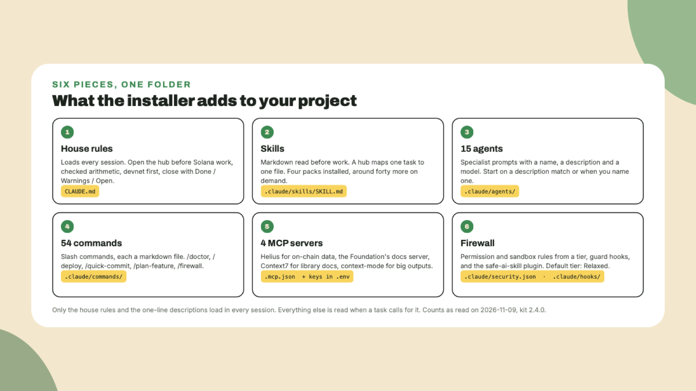

# What you are installing

By the end of the workshop, Claude Code on your machine will **read Solana's current references before it writes a line**, and a firewall will sit between it and your wallet. This lesson is the one to read *before* the workshop starts, so that the install lesson begins with everyone holding the same four things.

## The kit in one paragraph

The Solana AI Kit is **a folder of configuration for Claude Code**. That is the whole definition. Nothing in it is a program you run, and nothing in it is a Solana program. It is markdown that Claude reads, a few JSON files that Claude Code reads, and some small shell scripts that run as hooks. Superteam Brasil maintains it, it is MIT licensed, and the source is at [github.com/solanabr/ai-kit](https://github.com/solanabr/ai-kit). As read on 2026-11-09 the version was **2.4.0**, and *the README wins over this lesson* wherever the two disagree, because the kit moves faster than a course does.

## Six pieces, one folder

The install drops six kinds of things into your project, **one plain line each**:

1. **`CLAUDE.md`** is the house rules. It loads in every session and tells Claude to open the skill hub before any Solana work, to use checked arithmetic, to deploy to devnet first, and to end every reply with what landed and what is still open.
2. **Skills** are markdown files Claude reads *before* it works. A hub file maps your task to the one reference to read first. Four skill packs come installed, and around forty more install on demand.
3. **Agents** are specialist prompts: an architect, an Anchor engineer, a QA engineer, a guide for learners, and eleven more, **15 in total**, each a markdown file with a name, a description and a model.
4. **Commands** are the slash commands, **54 of them**, each a markdown file. `/doctor` checks your setup, `/deploy` deploys, `/quick-commit` commits on a kit-named branch.
5. **MCP servers** are the tools Claude Code can call for data and docs: Helius for on-chain data, the Solana Foundation's docs server, Context7 for library docs, and context-mode to keep big outputs out of the conversation. **Four are on by default.**
6. **The firewall** is a set of permission and sandbox rules generated from a tier, plus the **safe-ai-skill** plugin that gates mainnet, value-moving and secret-reading actions. The default tier is called Relaxed, and *it is the right one for a workshop*.

The idea behind all six is that **almost none of it loads until a task needs it**. Only `CLAUDE.md`, the one-line descriptions of agents and commands, and two short skill descriptions are in every session. A skill body, an agent body or a command body is read when your request calls for it. So the kit is big on disk and small in the conversation, by design.

## The website, the installer and the source

There are three URLs you will see, and it is worth keeping them apart from the start:

- **[kit.superteam.codes](https://kit.superteam.codes)** is the website. Its name on the page is *Solana Skills*. It hosts the official skills from the Solana Foundation and Superteam Brasil as plain markdown, and it indexes skills from around thirty ecosystem repositories. The same site answers at `ai.superteam.codes`.
- **`aikit.superteam.codes`** is the installer. It redirects to the install script in the GitHub repository, so `curl` on that address downloads a shell script, nothing more.
- **[github.com/solanabr/ai-kit](https://github.com/solanabr/ai-kit)** is the source, with a `docs/` folder that is *never copied into your project*. When a lesson here says "the firewall doc", that is where it lives.

## What you need on your machine

Have these four before the workshop, because **the install lesson does not stop for them**:

- **Claude Code**, installed and signed in. `claude --version` in a terminal should print a version.
- **Node 22 or newer.** The kit's health check accepts 18, but one of the default MCP servers wants 22.5 or newer, and the Colosseum skill wants 20. *Twenty-two keeps everything happy.*
- **git**, because the first thing you do is create a repository, and one of the commands you will run commits to it.
- **An empty folder** for the workshop project. Call it anything. The lessons call it `kit-workshop`.

Three things you do **not** need today: Rust, Anchor and the Solana CLI. The health check will list the Solana CLI as missing and print the one command that installs it, and you can run that after the workshop. Everything you do here runs on Node and on Claude Code, and I chose it that way *so that nobody spends the first half hour fighting a toolchain*.

On a native Windows machine the security plugin has no build yet and the installer skips it, so if you have the choice, run the workshop from WSL2 or from a Mac or Linux terminal.

## Next

Next lesson you `cd` into that empty folder, run `git init`, and download the installer **to read it before you run it**. The reading takes two minutes, and it is the one habit in this course that applies to every `curl | bash` you will ever meet.
