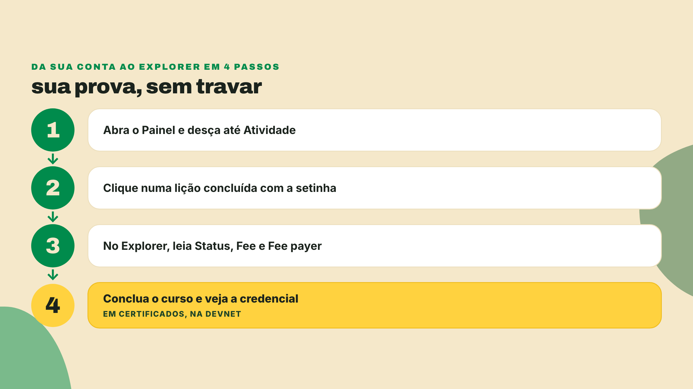
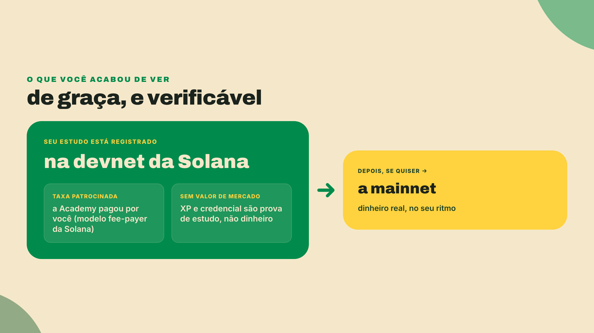
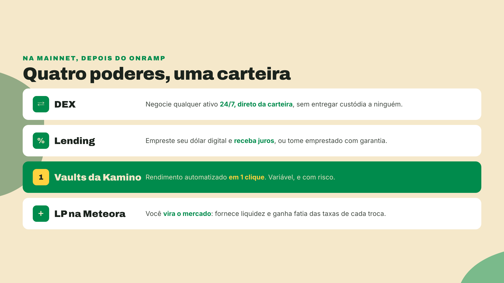
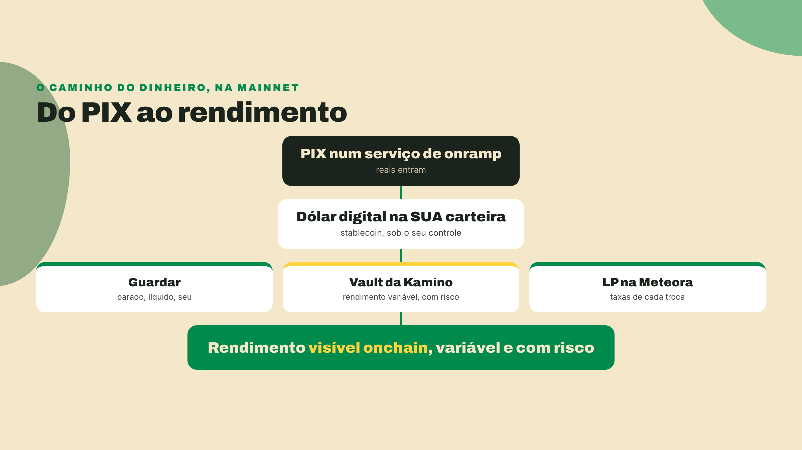

# Seu momento onchain

Chega de teoria. Com a matrícula feita, cada lição que você conclui vira um registro na Solana. Agora você vai abrir essa prova com os próprios olhos, no mesmo painel público que qualquer pessoa usa para conferir a rede.

Siga os quatro passos, um de cada vez. Ainda não se matriculou? Use o botão **Matricular-se** antes (sem conta, o mesmo botão pede para você entrar antes). Lição lida antes da matrícula não conta: depois de se matricular, conclua as lições anteriores, passando nos quizzes, e volte para cá.

1. Abra o **Painel** da Academy e desça até **Atividade**.
2. Clique numa lição concluída que tenha uma setinha no canto da linha. O Solana Explorer abre direto naquela transação, na rede Devnet. Se você está matriculado e acabou de concluir uma lição, a linha inteira pode demorar um pouco a aparecer: espere e recarregue.
3. Leia três campos. **Status** diz se deu certo, **Fee** mostra a taxa em SOL e **Fee payer** mostra quem pagou. Depois procure `CompleteLesson` e `MintTo` nos logs (aba **Programs & Logs** em tela larga, aba **Logs** em tela menor; no celular, role a página até os logs): é o programa da Academy marcando a sua lição e emitindo o seu XP.
4. Passe no quiz abaixo e conclua esta lição. Com as quatro lições concluídas, a sua credencial do curso é emitida automaticamente e aparece em **Certificados**. Abra a credencial para encontrar o botão **Ver no Solana Explorer**. Se ela não aparecer, o **Painel** mostra o botão **Emitir Certificado**.

Sejamos honestos sobre o que esse registro é. A Academy roda hoje na devnet, a rede da Solana feita para testes. O SOL de lá não tem valor de mercado, e o seu XP e a sua credencial não são dinheiro nem ativo na mainnet: não dá para vender nem trocar por nada. O que eles são: registros públicos, que qualquer pessoa confere sem pedir permissão a ninguém. E o endereço em Fee payer não é o seu porque a Academy pagou a taxa por você. Esse modelo de fee-payer é padrão na Solana.

A mainnet é onde tudo o que você viu na lição 1 acontece com dinheiro de verdade. É um passo à parte: este curso não entrega nenhum ativo na mainnet, e a Academy não dá esse passo por você. Se um dia você quiser dar, o caminho costuma ser assim. Você precisa de uma carteira própria, como a [Phantom](https://phantom.com) ou a [Solflare](https://solflare.com), e de um onramp: um serviço que converte reais, muitas vezes por PIX, em dólar digital (stablecoin). A Academy não indica um onramp específico. Antes de usar um, compare as taxas, veja que cadastro ele exige e confirme se o valor cai na sua carteira ou fica numa conta dentro do serviço. Com o dólar digital na sua carteira, quatro poderes se destravam.

Os apps de cada categoria estão abertos agora, na mainnet: a [Jupiter](https://jup.ag) para trocas, a [Kamino](https://kamino.com) para lending e vaults (cofres que executam uma estratégia automática: você deposita e ela trabalha) e a [Meteora](https://meteora.ag) para quem fornece liquidez. Nada de fila: abriu, conectou a carteira, está dentro.

Uma nota honesta antes de você sair correndo: na mainnet o dinheiro é de verdade, e uma transação errada não tem botão de desfazer. Rendimento em DeFi é variável, ninguém garante juro fixo, e todo protocolo tem risco. Nunca passe a sua frase de recuperação para ninguém. Comece pequeno, entenda o que está fazendo, e cresça no seu ritmo.

Você também não precisa de dinheiro nenhum para continuar. Quer ganhar pelo trabalho? O [Superteam Earn](https://superteam.fun/earn/) da lição anterior tem tarefas abertas. Quer **construir**? O próximo passo é o curso "From Bitcoin to Solana" (btc-to-sol-evolution): do primeiro hash ao seu próprio programa rodando na Solana (por enquanto, em inglês).

Assim que tiver uma lição concluída com matrícula, abra o Painel e confira a sua transação. Bem-vindo ao mundo onchain. 🚀
