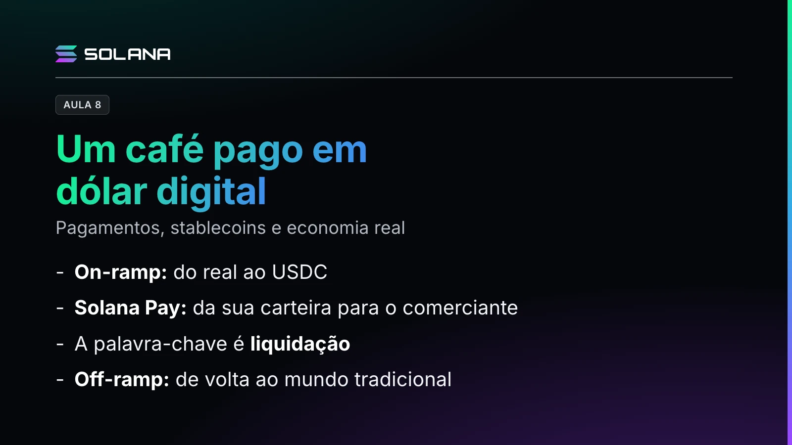

Você está em uma cafeteria e você lê lá: "Aceitamos USDC, dólar digital, pela Solana". Aí você fala: nossa, mas eu tenho reais na minha carteira, e vou pagar em dólar digital, vou pagar em USDC?

Vamos entender aqui, num passo a passo.

## Primeiro passo: entender o USDC

Primeiro passo, você precisa entender que o USDC é um token e que você vai usar uma carteira digital para transferir esse valor para o comerciante, como você faz hoje aqui no Brasil usando o Pix.

## Do real ao dólar digital

Bom, se você ainda não tem dólar digital, o USDC, você vai ter que se utilizar de um fornecedor. Ele tem um termo técnico, chamado on-ramp, onde você traz dinheiro do mundo tradicional para esse mundo cripto. Então você vai precisar verificar as condições de taxa, a quanto o pessoal compra, para você sair de real e chegar em USDC, que é o dólar digital.

Para trazer esse dólar para a sua carteira, você lembra que nós já falamos disso, você precisa dar o endereço, como uma chave Pix, para onde esse USDC deve ser encaminhado. Você pagou em real, a pessoa faz a conversão, como se fosse um dólar em papel, e aí esse dólar digital vai para a sua carteira. Por isso você precisa dar o endereço.

E sempre confira as transações, né? Veja se realmente o dinheiro que saiu em real foi transferido em dólar USDC. Saiba que tem as taxas de serviço, então sempre faça a conta da conversão para saber se está tudo ok.

## Pagar com Solana Pay

Um instrumento que você pode usar nesse próximo passo é o Solana Pay. Como hoje nós temos métodos de pagamento de encostar o celular nas maquininhas, no Solana Pay você vai fazer essa transferência da sua conta corrente digital, cripto, para o comerciante.

Cuidado: nessa etapa, essa transferência é feita pelo token USDC. Ele vai estar recebendo na outra ponta não reais, vai estar recebendo dólar digital. Lembra da plaquinha? Ela dizia que recebia USDC via Solana. É o que você está fazendo.

## Conferir o destino

A leitura da transferência, para onde vai o dinheiro lá no comerciante, pode ser feita através de um QR Code, como a gente também faz aqui com o Pix, né? Você tem uma chave, você pode bater lá no seu celular, pelo aplicativo, ler o QR Code e saber para onde vai. No Solana Pay é a mesma coisa, para direcionar corretamente o valor da conta do café que você está pagando.

## A palavra-chave é liquidação

Você somente tem certeza de que a transação ocorreu de maneira efetiva quando a gente diz: a liquidação da operação aconteceu. Aí sim, aquele barulhinho que muitas vezes você escuta na máquina de cartão de crédito ou débito, tipo "transação feita". Aqui a palavra-chave é liquidação.

## Voltar ao mundo tradicional

Então, agora o comerciante, de posse desse dólar digital, vai fazer, o termo agora é off-ramp. Ele vai sair do mundo cripto e vai voltar para o mundo tradicional, das finanças tradicionais. Por quê? Ele quer dinheiro, né? Ele quer real, ele quer dólar. Então ele também tem que fazer o caminho de converter o dólar digital para o dinheiro da moeda local.

## Precisa converter?

Mas nem sempre você precisa fazer essa conversão. De repente esse dono da cafeteria compra café importado também e paga o fornecedor em USDC. Então ele não precisa converter para a moeda local, ele já paga o fornecedor em dólar digital. Isso é legal.

Se é uma empresa que faz transações internacionais, o fornecedor recebe dólar digital e é interessante para ele. Por quê? Porque ele também se utiliza dessa moeda para fazer as outras transações: comprar café, de repente pagar lá o streaming da cafeteria dele, de repente fazer a manutenção das máquinas de café.

Então ele também se utiliza desse meio de pagamento, que são as moedas digitais, como o dólar. Ou, de repente, até o próprio SOL, com que ele paga as taxas da rede que está usando. De repente algum outro fornecedor também aceita até SOL. E tudo bem: dólar, SOL, a cripto que estiver sendo aceita.

## Para guardar

On-ramp é sair do real e chegar no USDC. Off-ramp é o caminho de volta para o mundo tradicional. No meio, o pagamento pelo Solana Pay, com o QR Code direcionando para a conta certa, e a palavra-chave é liquidação. E nem sempre precisa converter: o dólar digital também circula.
